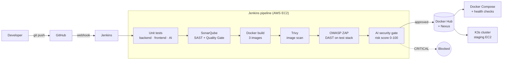

# AeroSec Tower — AI-Assisted DevSecOps Pipeline


An end-to-end **DevSecOps pipeline** that builds, tests, scans and deploys a containerized
full-stack application, and uses an **AI risk engine** to decide whether a release is allowed
to go to production.

> Master's final project (Projet de Fin d'Études) — *Solution DevSecOps intelligente pour la
> prédiction des risques de déploiement* — carried out at HD Solution and defended in October 2026
> (mention Très Bien). The application itself, **AeroSec Tower**, is a simulated airport-tower
> monitoring console used as the workload; it is not a real air traffic control system.

---

## Highlights

- **One push, full pipeline** — a GitHub webhook triggers a declarative Jenkins pipeline that
  runs tests, security scans, image builds, registry pushes and deployment with no manual step.
- **Three layers of security testing** — SAST with SonarQube (blocking Quality Gate),
  SCA / image scanning with Trivy (fails on fixable `HIGH` / `CRITICAL` CVEs) and DAST with an
  OWASP ZAP baseline scan against an ephemeral test stack.
- **AI security gate** — a FastAPI service scores deployment risk (0–100) with an LLM, backed by
  deterministic rules that the model can never score below. `CRITICAL` blocks the release,
  `HIGH` marks it for manual review.
- **Fail-safe by design** — if the AI service is unreachable, it never auto-approves; the
  decision falls back to the rule-based score with `manual-review`.
- **Real deployment targets** — images are published to Docker Hub and a Nexus registry, then
  deployed with Docker Compose and rolled out to a **K3s** cluster on **AWS EC2**.
- **Hardened images** — multi-stage builds, patched OS packages and package managers stripped
  from runtime images to reduce the attack surface.

## Architecture



### Application stack

| Layer | Technology |
|---|---|
| Frontend | React, Vite, TailwindCSS, Recharts, Socket.io client, served by Nginx |
| Backend | Node.js, Express, JWT, bcrypt, Helmet, rate limiting, Socket.io |
| AI engine | Python, FastAPI, Pydantic, xAI Grok API with rule-based fallback |
| Database | PostgreSQL 16 |
| Delivery | Jenkins, SonarQube, Trivy, OWASP ZAP, Nexus, Docker Hub, Docker Compose, K3s, AWS EC2 |

## Pipeline stages

Defined in [`Jenkinsfile`](Jenkinsfile):

| # | Stage | What it does | Gate |
|---|---|---|---|
| 1 | Checkout | Clean workspace and pull the commit that triggered the build | |
| 2 | Install dependencies | `npm ci` for backend and frontend, in parallel | |
| 3 | Tests | Backend, frontend and AI-engine unit tests in parallel, with coverage | Fails on test failure |
| 4 | SonarQube analysis | Static analysis of backend and frontend with merged coverage | |
| 5 | Quality Gate | Waits for the SonarQube verdict | **Blocks** if the gate fails |
| 6 | Build images | Builds backend, frontend and AI-engine images, tagged with the build number and stamped with commit metadata | |
| 7 | Trivy scan | Scans all three images for vulnerabilities | **Blocks** on fixable `HIGH` / `CRITICAL` |
| 8 | Test stack | Starts the built images with Docker Compose | |
| 9 | OWASP ZAP baseline | Passive DAST scan of the running app; HTML + JSON reports archived | **Blocks** on `FAIL`, unstable on `WARN` |
| 10 | AI security gate | Calls the AI engine's `/analyze` endpoint and parses its JSON risk decision | **Blocks** on `CRITICAL` (≥ 90), unstable on `HIGH` (≥ 70) |
| 11 | Tear down | Stops the ephemeral test stack | |
| 12 | Push images | Publishes to Docker Hub (private) and the Nexus Docker registry | |
| 13 | Archive reports | Uploads the AI risk report to Nexus | |
| 14 | Deploy + health checks | Redeploys with Docker Compose and waits for backend and AI engine to be healthy | Fails if unhealthy |
| 15 | Deploy to K3s | Applies Kubernetes manifests with the build's image tag and waits for each rollout | Fails if a rollout times out |

All credentials (Docker Hub, Nexus, SonarQube, kubeconfig) are injected from the Jenkins
credentials store with `withCredentials` — none are stored in the repository.

## AI risk engine

The engine ([`App/ai-engine/main.py`](App/ai-engine/main.py)) exposes `POST /analyze` and returns:

```json
{
  "risk_score": 95,
  "risk_level": "CRITICAL",
  "signals": ["injection-attempt", "critical-exposure"],
  "recommended_action": "block",
  "analysis_status": "success",
  "explanation": "...",
  "remediation": ["..."]
}
```

| Score | Level | Pipeline decision |
|---|---|---|
| 0–29 | LOW | approve |
| 30–69 | MEDIUM | approve |
| 70–89 | HIGH | manual review (build marked unstable) |
| 90–100 | CRITICAL | block |

Design choices worth noting:

- **The model does not decide on its own.** The LLM returns a score and explanation; the
  thresholds are enforced in code, and the final score is `max(llm_score, rule_score)` so the
  model can never undercut known risk indicators.
- **Logs are treated as untrusted input.** The system prompt instructs the model to ignore
  instructions embedded in log content (prompt-injection defence), and the response is
  validated for type and range before use.
- **No silent approval.** Any API error, timeout or malformed answer returns the rule-based
  score with `recommended_action: manual-review`.

## Validation: blocking a vulnerable dependency

To prove the gates actually stop a release, a known-vulnerable package was injected into the
AI engine:

```bash
echo "urllib3==1.26.4" >> App/ai-engine/requirements.txt
git commit -am "inject vulnerable dependency" && git push
```

Trivy flagged the known `HIGH`-severity vulnerabilities in `urllib3` 1.26.4 and failed the build at stage 7, so **no
image was pushed and nothing was deployed**. Removing the line restored a green pipeline.
Repeat the same steps to reproduce the demo.

## Run it locally

Requirements: Docker with the Compose plugin.

```bash
git clone https://github.com/Alaadhouioui/ai-devsecops-pipeline.git
cd ai-devsecops-pipeline/App
docker compose up --build
```

| Service | URL |
|---|---|
| Frontend | http://localhost:5173 |
| Backend API | http://localhost:5000/api |
| AI engine | http://localhost:8001 |

Seeded demo account: `operator@aerosec.local` / `Operator123!` (other roles are listed on the
login page). Without an `XAI_API_KEY`, the AI engine runs in its rule-based fallback mode.

To run the CI tooling yourself, see [`jenkins/`](jenkins) and [`sonarqube/`](sonarqube) for the
Compose files, and [`App/docs/github-webhook.md`](App/docs/github-webhook.md) for the webhook setup.
The pipeline expects these Jenkins credentials: `dockerhub-creds`, `nexus-creds`,
`k3s-kubeconfig`, and a SonarQube server named `sonarqube`.

## Repository structure

```text
.
├── Jenkinsfile              # Declarative CI/CD pipeline
├── k8s/                     # K3s manifests (backend, frontend, AI engine, PostgreSQL)
├── jenkins/                 # Jenkins server (Docker Compose)
├── sonarqube/               # SonarQube + PostgreSQL (Docker Compose)
└── App/
    ├── frontend/            # React dashboard (Nginx in production)
    ├── backend/             # Express API, JWT auth, audit logs
    ├── ai-engine/           # FastAPI risk engine
    ├── docker/              # Database init script
    ├── docs/                # Architecture and full project write-up
    └── docker-compose.yml   # Local / test stack
```

## Known limitations and next steps

This is a demonstration environment, and some choices were made for reproducibility rather
than production:

- Demo database and JWT values are set in `docker-compose.yml` and `k8s/*.yaml`; production
  should load them from Kubernetes Secrets or a secrets manager (Vault, AWS Secrets Manager).
- Trivy runs with a pre-downloaded vulnerability database (`--skip-db-update`) to keep build
  times stable; the database must be refreshed on a schedule.
- The AI gate currently sends a fixed pipeline event; the next iteration feeds it the actual
  Trivy, ZAP and SonarQube results so the score reflects each build's findings.
- Next steps: secret scanning (Gitleaks) as a pipeline stage, image signing with Cosign,
  Kubernetes Secrets and NetworkPolicies, and Helm charts for the K3s deployment.

## Author

**Alaa Dhouioui** — DevSecOps & Cloud Security
[LinkedIn](https://www.linkedin.com/in/alaa-dhouioui-15407a223) ·
[Docker Hub](https://hub.docker.com/u/dhouiouialaaa)
